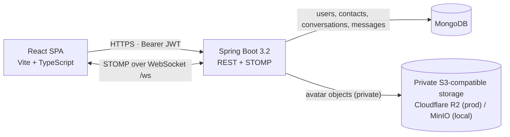

# Fairish Chat

Fairish Chat is a full-stack 1-to-1 messaging application built with a Spring Boot
backend, a React/TypeScript frontend, MongoDB, and real-time STOMP messaging over
WebSocket. Messaging is restricted to **accepted contacts**, and avatars are stored
in a **private** S3-compatible bucket and served only through an authenticated proxy.

The project is intentionally conventional: one backend service, one SPA, one database,
and one storage dependency. There are no service abstractions that exist only to look
enterprise-shaped.

## Implemented features

- **Authentication**: registration, login, stateless JWT (HS256), BCrypt password hashing.
- **Profiles**: view/update username and bio; upload/remove a private avatar.
- **User discovery**: search by exact 24-character Fairish User ID or by username substring.
- **Contacts**: send, accept, decline, and cancel requests; list incoming/outgoing requests
  and accepted contacts; remove contacts.
- **Contact-gated chat**: conversations, message history, message sending, and STOMP
  subscribe/send are all denied unless the pair has an `ACCEPTED` contact request.
- **1-to-1 conversations**: deterministic pair keys, duplicate-safe creation, paginated
  message history (newest first), message length validation (1–2000 characters).
- **Real-time delivery**: STOMP over native WebSocket (with SockJS fallback) at `/ws`,
  conversation topics at `/topic/conversations/{id}`.
- **Private avatars**: server-side validation and normalization, private bucket, no public
  or presigned URLs, owner-or-accepted-contact authorization.

Not implemented: end-to-end encryption, presence, typing indicators, read receipts, group
chats, message attachments, push notifications, and rate limiting. See
[Known limitations](#known-limitations).

## Architecture



Request flow:

1. The SPA authenticates via `/api/auth/*` and stores the JWT.
2. REST calls send `Authorization: Bearer <token>`; the backend resolves the user from the
   token. User IDs are never trusted from request bodies when the authenticated user is the
   actor.
3. The SPA connects to `/ws` with the token and subscribes to a conversation topic only
   after the backend authorizes the subscription.
4. Chat authorization is centralized in `ConversationService`; REST and STOMP paths share
   the same check, so a client cannot bypass the contact rule by switching protocols.
5. Avatar bytes live in a private bucket. The backend is the only reader and returns the
   bytes only to the owner or an accepted contact.

### Backend packages

```
com.fairish.chat
├── config/      Spring, CORS, WebSocket, dotenv, avatar storage wiring
├── controller/  REST controllers + STOMP message mappings
├── dto/         Request/response contracts (public projections omit email)
├── exception/   Domain exceptions + centralized JSON error handler
├── model/       MongoDB documents (User, ContactRequest, Conversation, Message)
├── repository/  Spring Data MongoDB repositories
├── security/    JWT filter/service, SecurityConfig, STOMP auth interceptor
├── service/     Business logic and authorization policy
└── storage/     AvatarStorage abstraction + S3 adapter + disabled fallback
```

### Frontend structure

```
frontend/src
├── api/          axios client, REST clients, STOMP service
├── components/   Sidebar, ContactsPanel, Avatar, Navbar, etc.
├── context/      AuthContext (session state)
├── pages/        Login, Register, Dashboard, Profile, 404
├── types/        TypeScript contracts (user, contact, conversation, message)
└── config/       build-time validated environment configuration
```

## Authorization model

### Authentication

- Passwords are hashed with BCrypt and never returned by the API.
- JWTs are HMAC-SHA256, signed with `JWT_SECRET` (minimum 32 bytes), and validated on every
  request by `JwtAuthenticationFilter`.
- The API is stateless: no server-side HTTP session. Logout is a client-side token discard.
- Public routes: `/api/auth/**`, `/api/health`, `/ws/**` (the STOMP handshake authenticates
  the `CONNECT` frame). Everything else requires a valid token.

### Contact lifecycle

A pair of users has at most **one** `ContactRequest` document, keyed by an unordered pair key.
Status values are `PENDING`, `ACCEPTED`, `DECLINED`, and `CANCELLED`.

| Action | Who may perform it | Result |
|---|---|---|
| Send request | Any authenticated user, not to self | `PENDING`; duplicate request → `409` |
| Accept | Recipient only | `ACCEPTED`; chat becomes available |
| Decline | Recipient only | `DECLINED`; request leaves the incoming list |
| Cancel | Requester only | `CANCELLED`; request leaves the outgoing list |
| Remove contact | Either accepted contact | Pair document deleted; access revoked |

`DECLINED` and `CANCELLED` requests can be re-opened by sending a new request; the same
document returns to `PENDING`. Only `ACCEPTED` grants chat or avatar access.

### Chat policy

`ConversationService.getConversationAndValidateParticipant(...)` is the single authorization
primitive. It verifies that:

1. the conversation exists,
2. the authenticated user is a participant, and
3. the two participants are still accepted contacts.

That method is used by:

- REST conversation lookup, message history, and message sending;
- STOMP `SUBSCRIBE /topic/conversations/{id}`;
- STOMP `SEND /app/conversations/{id}/sendMessage` and `/app/chat.sendMessage`.

Conversation creation also requires an accepted contact, and the conversation list only
returns conversations whose counterpart is an accepted contact.

**Removing a contact revokes access immediately** but does **not** delete conversation or
message history. If the pair becomes accepted contacts again, the preserved history becomes
visible again. Direct API calls and WebSocket frames receive `403` / an `AccessDeniedException`
while the relationship is pending, declined, cancelled, or removed.

### Avatar privacy

- The bucket is private; objects are never public and no presigned/public URL is generated.
- `GET /api/users/{id}/avatar` requires authentication and allows only:
  - the owner, or
  - a user with an `ACCEPTED` contact relationship with the owner.
- Other users (including conversation participants whose contact was removed) receive `403`.
- Uploads accept JPEG or PNG only, up to 5 MB, and are center-cropped to 512×512. Images are
  re-encoded, which strips EXIF/GPS metadata. The storage key is stored privately on the user
  document and never exposed.
- Public user payloads expose only `hasAvatar` and `avatarUpdatedAt` metadata.

## Local setup

### Prerequisites

- Java 21+ (the build targets Java 21)
- Node.js 18+ and npm
- Docker Desktop (recommended for MongoDB and MinIO) or your own MongoDB instance

### 1. Start local dependencies

From the repository root:

```bash
docker compose up -d
```

This starts:

| Service | Address | Purpose |
|---|---|---|
| MongoDB | `localhost:27017` | application database |
| MinIO S3 API | `http://localhost:9000` | avatar storage |
| MinIO console | `http://localhost:9001` | inspect the private bucket (login with the dev credentials) |

The backend creates the `fairish-avatars` bucket on first use
(`AVATAR_STORAGE_CREATE_BUCKET=true`). No manual bucket setup is required.

> The compose credentials are **local development only**. If you already have a
> `backend/.env` pointing at MongoDB Atlas, you can keep it and run only the MinIO service
> (`docker compose up -d minio`).

### 2. Configure and start the backend

```bash
cd backend
cp .env.example .env      # Windows: copy .env.example .env
```

Set `JWT_SECRET` in `backend/.env` to a random value of at least 32 bytes:

```bash
openssl rand -base64 48
```

The template already contains MinIO settings that match `docker-compose.yml`. If your
existing `.env` predates avatar support, add the `AVATAR_*` block from `.env.example`;
without it avatar storage defaults to disabled and avatar endpoints return `503`.

Run:

```bash
# Windows
.\mvnw.cmd spring-boot:run

# macOS / Linux
./mvnw spring-boot:run
```

The backend listens on `http://localhost:8080`. Verify with:

```bash
curl http://localhost:8080/api/health
```

`backend/.env` is loaded automatically by `DotenvEnvironmentPostProcessor`. OS environment
variables and `-D` system properties take precedence over `.env` values.

### 3. Configure and start the frontend

```bash
cd frontend
cp .env.example .env      # Windows: copy .env.example .env
npm install
npm run dev
```

Open `http://localhost:5173`.

`VITE_API_BASE_URL` is required before the dev server or build starts. In production builds
it must be an HTTPS URL and must not point at localhost; the same applies to `VITE_WS_URL`
when provided.

## Environment variables

### Backend

| Variable | Required | Description | Default |
|---|---|---|---|
| `PORT` | No | HTTP port | `8080` |
| `SPRING_PROFILES_ACTIVE` | No | Set to `prod` in production | unset |
| `MONGODB_URI` | Yes* | MongoDB connection URI | `mongodb://localhost:27017/fairish_chat` |
| `MONGODB_DATABASE` | No | Database name | `fairish_chat` |
| `JWT_SECRET` | Yes | HS256 secret, minimum 32 bytes | none — startup fails |
| `JWT_EXPIRATION` | No | Token lifetime in ms | `86400000` (24 h) |
| `CORS_ALLOWED_ORIGINS` | In `prod` | Comma-separated exact frontend origins | localhost dev origins |
| `AVATAR_STORAGE_ENABLED` | No | Enable S3 avatar storage | `false` in dev config; `true` in `prod` |
| `AVATAR_STORAGE_ENDPOINT` | For MinIO/R2 | S3 endpoint URL | empty (AWS default) |
| `AVATAR_STORAGE_REGION` | No | S3 region (`auto` for R2) | `us-east-1` |
| `AVATAR_STORAGE_BUCKET` | No | Private bucket name | `fairish-avatars` |
| `AVATAR_STORAGE_ACCESS_KEY` | When enabled | Access key ID | none |
| `AVATAR_STORAGE_SECRET_KEY` | When enabled | Secret access key | none |
| `AVATAR_STORAGE_PATH_STYLE_ACCESS` | No | Path-style addressing (MinIO: `true`, R2: `false`) | `true` |
| `AVATAR_STORAGE_CREATE_BUCKET` | No | Create the bucket if missing (MinIO) | `true` |
| `AVATAR_MAX_UPLOAD_BYTES` | No | Maximum avatar upload size | `5242880` (5 MB) |
| `AVATAR_MAX_REQUEST_BYTES` | No | Multipart request limit | `6MB` |
| `AVATAR_OUTPUT_SIZE` | No | Normalized avatar edge length in px | `512` |

\* `MONGODB_URI` has a localhost default, so it is only strictly required when the database
is not running on the default local address.

The `prod` profile defaults avatar storage to enabled and fails fast if credentials are
missing. It also requires `CORS_ALLOWED_ORIGINS`, disables exception details in error
responses, and trusts `X-Forwarded-*` headers.

### Frontend

| Variable | Required | Description |
|---|---|---|
| `VITE_API_BASE_URL` | Yes | Backend REST base URL, e.g. `https://api.example.com/api` |
| `VITE_WS_URL` | No | WebSocket base URL, e.g. `wss://api.example.com/ws`; derived from the API URL when omitted |

`VITE_*` values are public and embedded in the client bundle. Never put secrets in them.

## REST API

All endpoints return JSON. Protected endpoints require `Authorization: Bearer <token>`.
Errors use a consistent shape: `{ timestamp, status, error, message, path }` (plus
`validationErrors` for bean-validation failures).

### Public

| Method | Endpoint | Description |
|---|---|---|
| `GET` | `/api/health` | Uptime check |
| `POST` | `/api/auth/register` | Create an account |
| `POST` | `/api/auth/login` | Log in with email or username |
| `POST` | `/api/auth/logout` | Client-side logout acknowledgment |

### Users and avatars

| Method | Endpoint | Description |
|---|---|---|
| `GET` | `/api/users/me` | Own profile (includes email) |
| `PUT` | `/api/users/me` | Update username and/or bio |
| `GET` | `/api/users/search?query=...` | Exact 24-hex Fairish User ID lookup, otherwise username substring search |
| `POST` | `/api/users/me/avatar` | Upload avatar (`multipart/form-data`, part name `file`) |
| `DELETE` | `/api/users/me/avatar` | Remove avatar |
| `GET` | `/api/users/{id}/avatar` | Stream avatar bytes (owner or accepted contact only) |

Search results and other-user projections never include email addresses, storage keys, or
legacy profile-image URLs.

### Contacts

| Method | Endpoint | Description |
|---|---|---|
| `POST` | `/api/contacts/requests` | Send request (`{ "recipientId": "..." }`) → `201` |
| `GET` | `/api/contacts/requests/incoming` | Pending requests received |
| `GET` | `/api/contacts/requests/outgoing` | Pending requests sent |
| `POST` | `/api/contacts/requests/{id}/accept` | Accept (recipient only) |
| `POST` | `/api/contacts/requests/{id}/decline` | Decline (recipient only) |
| `DELETE` | `/api/contacts/requests/{id}` | Cancel (requester only) → `204` |
| `GET` | `/api/contacts` | Accepted contacts |
| `DELETE` | `/api/contacts/{contactUserId}` | Remove contact → `204` |

### Conversations and messages

| Method | Endpoint | Description |
|---|---|---|
| `POST` | `/api/conversations` | Create or return a conversation (`{ "recipientId": "..." }`) → `201`; requires accepted contact |
| `GET` | `/api/conversations` | Conversations with accepted contacts only |
| `GET` | `/api/conversations/{id}` | Conversation details; requires accepted contact |
| `GET` | `/api/conversations/{id}/messages?page=0&size=20` | Paginated history, newest first; `size` is clamped to 1–100 |
| `POST` | `/api/conversations/{id}/messages` | Send message (`{ "content": "..." }`, 1–2000 characters) → `201` |

### Common status codes

| Status | Meaning |
|---|---|
| `400` | Validation failure or invalid state transition input |
| `401` | Missing/invalid/expired token, or bad credentials |
| `403` | Not a participant, or not accepted contacts |
| `404` | Resource not found |
| `409` | Duplicate resource or invalid contact-request transition |
| `413` | Avatar upload too large |
| `503` | Database or avatar storage unavailable, or avatar storage disabled |

## WebSocket / STOMP

- **Endpoint**: `/ws` (native WebSocket, plus a SockJS fallback registered on the same path)
- **Broker**: in-memory simple broker with `/topic` and `/queue` prefixes
- **Application prefix**: `/app`
- **Allowed origins**: the same `CORS_ALLOWED_ORIGINS` list

Authentication:

- Send the JWT as a STOMP `CONNECT` native header (`Authorization: Bearer <token>` or
  `token: <token>`), or
- Append `?token=<jwt>` to the WebSocket handshake URL. The frontend uses this query-parameter
  form and does not put the token in a URL fragment.

Subscribe and send:

| Frame | Destination | Notes |
|---|---|---|
| `SUBSCRIBE` | `/topic/conversations/{conversationId}` | Authorized only for participants who are accepted contacts |
| `SEND` | `/app/conversations/{conversationId}/sendMessage` | Body: `{ "content": "..." }` |
| `SEND` | `/app/chat.sendMessage` | Body: `{ "conversationId": "...", "content": "..." }` |

The inbound channel interceptor validates `CONNECT`, `SUBSCRIBE`, and `SEND`. Every send is
also re-validated inside `MessageService`, so the DTO/destination cannot be used to skip the
contact check.

## Testing

### Backend

```bash
cd backend
.\mvnw.cmd test      # Windows
./mvnw test          # macOS / Linux
```

Current result: **204 tests, 0 failures, 0 errors, 1 skipped**.

Coverage includes service-level policy tests, MockMvc controller tests, JWT/security tests,
avatar processing/storage tests, privacy serialization tests, and STOMP interceptor tests.
The contact rule is tested for creation, listing/filtering, REST history/send, and STOMP
subscribe/send after removal.

Test caveats:

- `S3AvatarStorageMinioTest` is a real MinIO round-trip via Testcontainers and is **skipped
  when Docker is unavailable** (the one skipped test in the count above).
- `AtlasConnectionTest` is **not hermetic**: it loads the local `.env` and attempts a live
  MongoDB Atlas ping, swallowing connection errors. Do not treat it as a deterministic
  integration test or run it in CI without an isolated database.
- There is no full end-to-end test that drives real MongoDB + HTTP + STOMP together; the
  authorization boundary is covered by unit, MockMvc, and interceptor tests.

### Frontend

```bash
cd frontend
npx tsc --noEmit
npm run build
```

The production build requires non-localhost URLs, for example:

```bash
# PowerShell
$env:VITE_API_BASE_URL='https://api.example.com/api'
$env:VITE_WS_URL='wss://api.example.com/ws'
npm run build
```

There is currently no frontend unit or end-to-end test script; validation is TypeScript
compilation plus a production build.

## Production notes

1. Activate the `prod` profile and set `JWT_SECRET`, `MONGODB_URI`, and
   `CORS_ALLOWED_ORIGINS` explicitly.
2. Use Cloudflare R2 (or another private S3-compatible bucket) with path-style access
   disabled and the bucket provisioned out of band. Keep the bucket private; the application
   never issues public or presigned URLs.
3. Terminate TLS at your reverse proxy and forward WebSocket upgrades for `/ws`.
4. Build the frontend with the public HTTPS API and WebSocket URLs.
5. Serve the SPA with a fallback rewrite to `index.html` (`frontend/public/_redirects` and
   `frontend/vercel.json` are included for common hosts).

## Known limitations

- **No end-to-end encryption.** Message content is stored in MongoDB in plaintext. TLS
  protects transport only; the server can read message data.
- **No presence, typing indicators, or read receipts.**
- **Single-instance real-time broker.** The STOMP simple broker is in-memory, so multiple
  backend instances do not share subscriptions. Horizontal scaling would require an external
  broker (e.g. RabbitMQ with a STOMP relay).
- **No rate limiting or abuse protection** on auth, search, contact requests, messages, or
  avatar uploads.
- **No group chats, message attachments, or push notifications.**
- **Contact removal is an access revocation, not a data deletion.** Conversation and message
  documents remain in MongoDB and become visible again if the contact is re-accepted.
- **Avatar delivery is proxied** through the backend (private cache, `Authorization`-varying)
  rather than served from a CDN.
