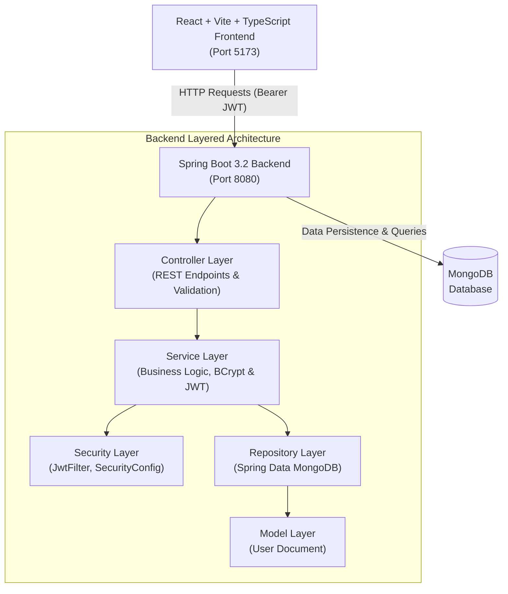

# Fairish Chat — Full-Stack Messaging Platform (Phase 1 & 2)

[](https://github.com)
[](https://openjdk.org)
[](https://spring.io/projects/spring-boot)
[](https://react.dev)
[](https://www.mongodb.com)

Fairish Chat is a production-oriented full-stack real-time messaging platform designed with clean architecture, modern engineering standards, and enterprise security practices.

> [!NOTE]
> **Phase 1 (Foundation & Auth)** and **Phase 2 (1-to-1 Conversations & Persistent Message History)** are complete and tested. Real-time WebSocket/STOMP delivery, typing indicators, and presence indicators are scheduled for Phase 3.

---

## 1. Phase 1 Scope & Features

- **Project Foundation**: Clean multi-module structure (`backend/` and `frontend/`) with reproducible Maven wrapper and Vite toolchain.
- **Stateless JWT Authentication**: Secure HMAC-SHA256 tokens passed via `Authorization: Bearer <token>` headers.
- **Spring Security 6 Integration**: Stateless session management, custom `AuthenticationEntryPoint`, Bean Validation, and protected routes.
- **BCrypt Password Hashing**: Passwords hashed securely with work factor before database persistence; password hashes are never exposed in API responses.
- **MongoDB Persistence**: `User` collection with unique indexing on `email` and `username`, audit timestamps (`createdAt`, `updatedAt`).
- **User Profile Management**: Endpoints and UI for inspecting and editing user profiles (`bio`, `profileImage`, `username`).
- **User Discovery / Search**: Case-insensitive substring username search endpoint (`/api/users/search?query=...`) for finding other users.
- **Global Error Handling**: Centralized `@RestControllerAdvice` delivering standardized JSON error responses without exposing server internals or stack traces.
- **Modern React Frontend**: Fast, responsive, accessible dark-theme UI with React Router, Axios interceptors, and Auth context.
- **Health Check Endpoint**: Public `/api/health` check for uptime monitoring.

---

## 2. Architecture Overview



---

## 3. Project Structure

```
fairish-chat/
│
├── backend/
│   ├── src/
│   │   ├── main/
│   │   │   ├── java/com/fairish/chat/
│   │   │   │   ├── config/             # CORS and Mongo Auditing config
│   │   │   │   ├── controller/         # REST Controllers (Auth, User, Health)
│   │   │   │   ├── dto/                # Request & Response Contracts
│   │   │   │   ├── exception/          # Custom Exceptions & Global Handler
│   │   │   │   ├── model/              # MongoDB Documents (User)
│   │   │   │   ├── repository/         # Spring Data Repositories
│   │   │   │   ├── security/           # JWT Service, Filter, SecurityConfig
│   │   │   │   ├── service/            # Business logic (Auth, User)
│   │   │   │   └── FairishChatApplication.java
│   │   │   └── resources/
│   │   │       └── application.yml     # Application configuration
│   │   └── test/                       # Unit & Integration Tests (29 tests)
│   ├── mvnw / mvnw.cmd                 # Maven Wrapper scripts
│   ├── pom.xml                         # Maven dependencies & build configuration
│   ├── .env.example                    # Environment variable template
│   └── README.md
│
├── frontend/
│   ├── src/
│   │   ├── api/                        # Axios instance & API client modules
│   │   ├── components/                 # Reusable components (Navbar, Sidebar, etc.)
│   │   ├── context/                    # AuthContext & state provider
│   │   ├── pages/                      # Login, Register, Dashboard, Profile, 404
│   │   ├── types/                      # TypeScript definitions
│   │   ├── App.tsx                     # Route definitions (Protected & Public)
│   │   └── main.tsx                    # Entry point
│   ├── package.json
│   ├── vite.config.ts
│   ├── tailwind.config.js
│   ├── .env.example
│   └── README.md
│
├── .gitignore
└── README.md
```

---

## 4. Environment Variables

### Backend (`backend/.env` or system environment)
| Variable | Description | Default / Example |
|---|---|---|
| `PORT` | Backend server port | `8080` |
| `MONGODB_URI` | MongoDB connection string | `mongodb://localhost:27017/fairish_chat` |
| `MONGODB_DATABASE` | MongoDB database name | `fairish_chat` |
| `JWT_SECRET` | 256-bit+ HMAC Secret Key | `DEV_ONLY_KEY_CHANGE_IN_PRODUCTION` |
| `JWT_EXPIRATION` | Token validity in milliseconds | `86400000` (24 hours) |
| `CORS_ALLOWED_ORIGINS` | Comma-separated allowed origins | `http://localhost:5173,http://localhost:3000` |

### Frontend (`frontend/.env`)
| Variable | Description | Default |
|---|---|---|
| `VITE_API_BASE_URL` | Backend REST API endpoint base URL | `http://localhost:8080/api` |

---

## 5. Quickstart Guide

### Prerequisites
- **Java 21+ JDK** installed (`java -version`)
- **Node.js 18+ & npm** installed (`node -v`, `npm -v`)
- **MongoDB** running locally on port 27017 or a free **MongoDB Atlas** connection string

### Step 1: Start Backend
```bash
cd backend

# Run with Maven wrapper (Windows PowerShell):
.\mvnw.cmd spring-boot:run

# Or on macOS/Linux:
./mvnw spring-boot:run
```
Backend will start on `http://localhost:8080`. Verify with `curl http://localhost:8080/api/health`.

### Step 2: Start Frontend
```bash
cd frontend

# Install dependencies
npm install

# Start Vite dev server
npm run dev
```
Open `http://localhost:5173` in your browser.

---

## 6. API Reference (Phase 1 & Phase 2)

### Public Endpoints
| Method | Endpoint | Description | Request Body | Response |
|---|---|---|---|---|
| `GET` | `/api/health` | Service health check | None | `{"status": "UP"}` |
| `POST` | `/api/auth/register` | Register new user | `{ "username": "...", "email": "...", "password": "..." }` | `201 Created` + `AuthResponse` |
| `POST` | `/api/auth/login` | Login user | `{ "identifier": "...", "password": "..." }` | `200 OK` + `AuthResponse` |
| `POST` | `/api/auth/logout` | Client logout acknowledgment | None | `200 OK` + message |

### Protected User Endpoints (Requires `Authorization: Bearer <token>`)
| Method | Endpoint | Description | Request Body | Response |
|---|---|---|---|---|
| `GET` | `/api/users/me` | Fetch current authenticated user profile | None | `200 OK` + `UserResponse` |
| `PUT` | `/api/users/me` | Update current user profile | `{ "username"?: "...", "bio"?: "...", "profileImage"?: "..." }` | `200 OK` + `UserResponse` |
| `GET` | `/api/users/search?query={q}` | Search users by username query | None | `200 OK` + `UserResponse[]` |

### Protected Conversation Endpoints (Requires `Authorization: Bearer <token>`)
| Method | Endpoint | Description | Request Body | Response |
|---|---|---|---|---|
| `POST` | `/api/conversations` | Create or retrieve 1-to-1 conversation | `{ "recipientId": "..." }` | `201 Created` + `ConversationResponse` |
| `GET` | `/api/conversations` | List user's active conversations | None | `200 OK` + `ConversationResponse[]` |
| `GET` | `/api/conversations/{id}` | Get conversation by ID (participants only) | None | `200 OK` + `ConversationResponse` |

### Protected Message Endpoints (Requires `Authorization: Bearer <token>`)
| Method | Endpoint | Description | Request Body | Response |
|---|---|---|---|---|
| `GET` | `/api/conversations/{id}/messages?page=0&size=20` | Get paginated message history (participants only) | None | `200 OK` + `PaginatedResponse<MessageResponse>` |
| `POST` | `/api/conversations/{id}/messages` | Send message (sender derived from JWT) | `{ "content": "..." }` | `201 Created` + `MessageResponse` |

---

## 7. Automated Testing

The backend includes a comprehensive suite of 57 unit and integration tests covering security, controllers, services, repositories, and exception handling.

```bash
cd backend
.\mvnw.cmd test
```

### Test Coverage Highlights
- `ConversationServiceTest`: Conversation creation, deterministic duplicate key prevention, self-conversation rejection (400), nonexistent recipient rejection (404), participant-only authorization enforcement (403), concurrent creation handling.
- `MessageServiceTest`: Persistent message storage, sender ID extraction from JWT principal, non-participant rejection (403), empty message rejection (400), oversized message rejection (400), reverse-chronological pagination.
- `ConversationControllerTest`: MockMvc tests for `POST /api/conversations`, `GET /api/conversations`, `GET /api/conversations/{id}`, and 403 Forbidden handling.
- `MessageControllerTest`: MockMvc tests for `POST /api/conversations/{id}/messages` (201), empty message (400), paginated `GET` (200), and non-participant forbidden (403).
- `JwtServiceTest`: Token generation, claim extraction, username verification, expired token rejection.
- `AuthServiceTest`: Successful registration, duplicate email rejection (409), duplicate username rejection (409), login validation, password mismatch handling.
- `UserServiceTest`: Profile retrieval, duplicate username check on update, safe profile modification, user search filtering.
- `AuthControllerTest`: MockMvc verification of register, login, validation errors, conflict responses, and logout.
- `UserControllerTest`: Profile endpoints, search endpoint, authentication principal mapping.
- `SecurityIntegrationTest`: Filter chain security, public endpoint accessibility, unauthenticated request rejection (401), valid Bearer token acceptance.
- `HealthControllerTest`: Health endpoint uptime check.
- `DotenvEnvironmentPostProcessorTest`: Local `.env` loading, property source precedence.
- `GlobalExceptionHandlerTest`: Diagnostic categorizations for data access, auth, timeout, and DNS errors.

---

## 8. Phases & Roadmap

### Phase 1: Foundation, Authentication & Users (Completed)
- [x] Backend architecture & clean packaging (`com.fairish.chat`)
- [x] User document & unique indexes
- [x] BCrypt password hashing & Bean validation
- [x] JWT authentication & Spring Security 6
- [x] User profile retrieval, update & search
- [x] Centralized error handling & health check
- [x] Full React + Vite + TypeScript frontend with auth guards

### Phase 2: Conversations & Persistent Message History (Completed)
- [x] MongoDB `Conversation` model with deterministic participant keys & duplicate prevention
- [x] MongoDB `Message` model with chronological compound indexes
- [x] Participant-only access control on conversations and message history (403 Forbidden)
- [x] Paginated message history loading (`PaginatedResponse`)
- [x] Secure sender identification derived from JWT authentication principal
- [x] Enhanced React dashboard with conversation list, user search, message bubbles, load older messages, and input bar
- [x] 100% automated test pass rate (57 tests passing)

### Future Phases (Roadmap)
- **Phase 3**: Real-time messaging (WebSocket / STOMP), User presence (Online/Offline status), Typing indicators, Delivery/Read receipts.
- **Phase 4**: Group chats, Media attachment uploads, Push notifications, Production containerization (Docker).

